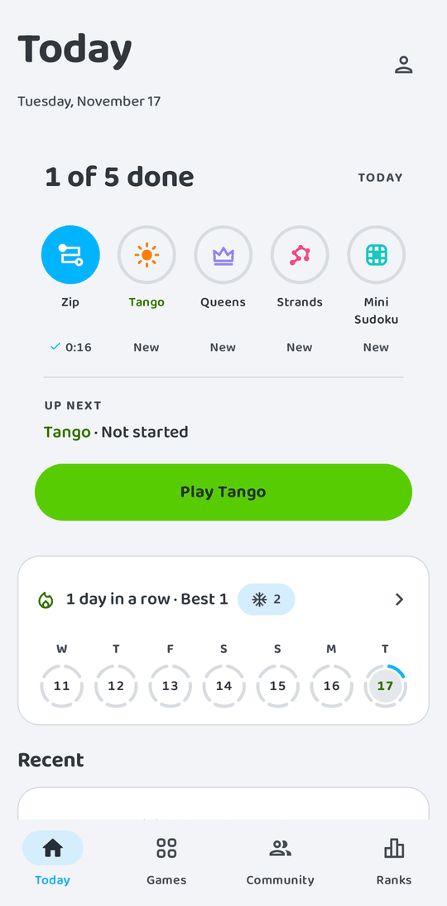
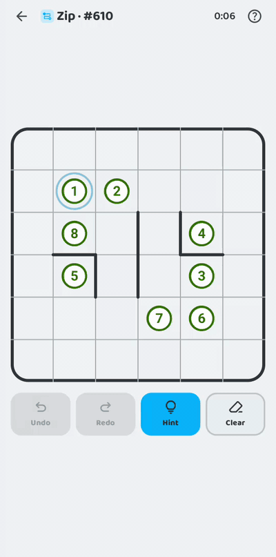
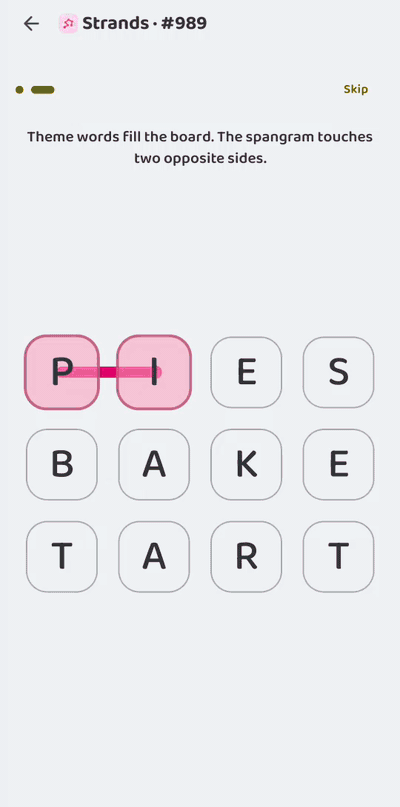
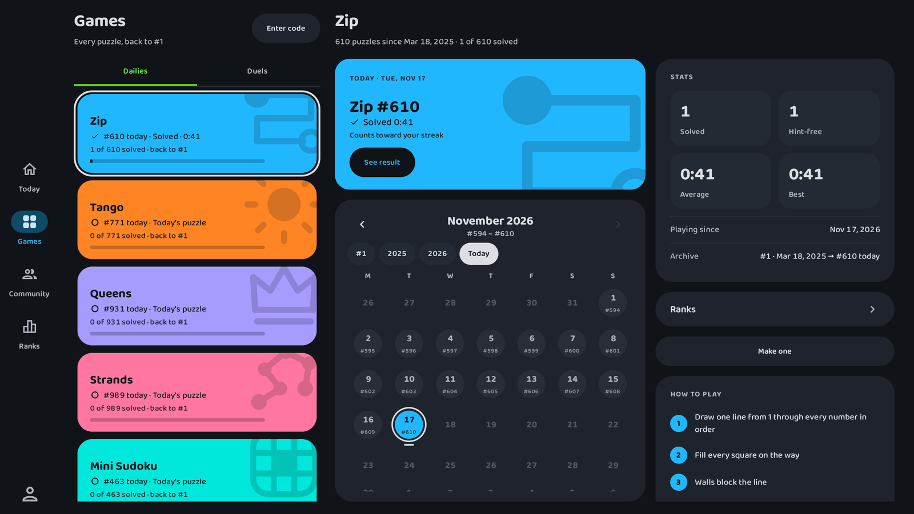
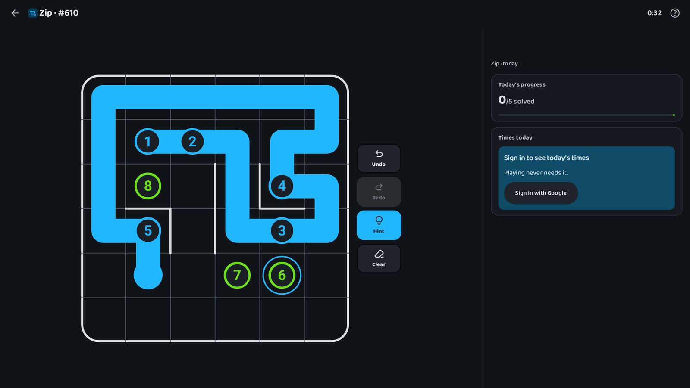
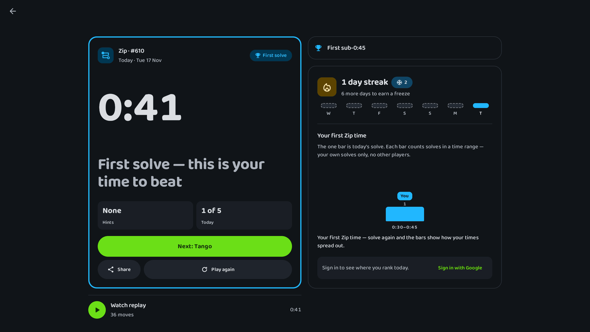
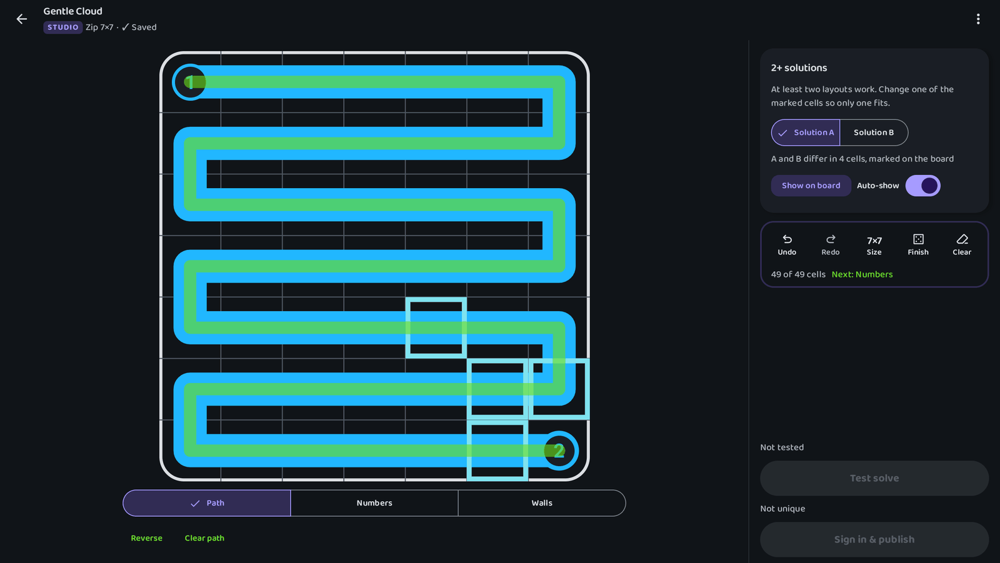
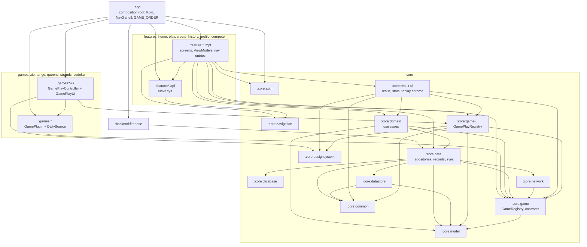

# PuzzleBox

One Android app for daily logic puzzles: play the NYT and LinkedIn dailies, build and share your own puzzles, and compete on per-game leaderboards and in 1v1 duels. Play never needs an account; signing in adds sync, ranks and duels.

> **Status: alpha (0.x), currently 0.41.0.** Zip, Tango, Queens, Mini Sudoku and Strands are playable, with a Studio editor for each. Leaderboards, duels, replays and cloud sync are shipped and behind Google sign-in.

<p align="center">
  
  &nbsp;
  
  &nbsp;
  
</p>

## Install

Download `PuzzleBox-<version>.apk` from the [latest release](https://github.com/ivanDsky/PuzzleBox/releases/latest) on your Android phone and open it; allow installs from your browser if Android asks. Release builds show an **Update available** pill on Today when a newer release is out.

## Features

### Play

- **Five dailies** in one place: Zip, Tango, Queens and Mini Sudoku (LinkedIn) and Strands (NYT). A 9x9 Sudoku runs on the same engine in debug builds only.
- **Every puzzle back to #1** — each game opens on today's puzzle with a calendar to jump to any earlier day, year or number.
- **Today at a glance** — progress for all five games, an "Up next" button and your streak.
- **Learn by playing** — a game's first play opens a few tiny practice boards, one rule at a time; How to play reopens them with the clock paused.
- **Staged hints, undo and redo**, and a reserved caption under the board that says why a move was refused, so the board never jumps.
- **Continue where you left off** — leave mid-puzzle and the clock stays where you stopped.
- **Honest best** — only a day's first solve can set a best time; replays are practice and say so.
- **Streak freezes** — you start with 2, earn more at 7 and 14 days and then every 28, up to 5.

### Create

- **Studio** — editors for Zip, Tango, Queens, Mini Sudoku and Strands. The editor tells you live whether your puzzle has one solution, shows two competing solutions when it has more, and has a **Finish** tool and **Test solve**.
- **Share** a puzzle by code or link (`https://puzzlebox-f3356.web.app/p/…`); the link opens straight in the app.
- **Import from text** — paste a puzzle, or share text from another app to PuzzleBox.
- **Community** — publish a puzzle you made and play other people's.

### Compete

- **Ranks** — per-game daily leaderboards with Friends and Global views, Day, Week and Month ranges plus an Overall rank, and per-account visibility settings.
- **Duels** — asynchronous 1v1, best of N, invite by code or `/m/` link. **Duel yourself** pits you against your own past solve.
- **Result screen** — your time, a distribution chart of your own solves, your rank and a "faster than last time" line.
- **Replays** — watch any accepted solve move by move, or compare two side by side.

### Everywhere

- **Cloud sync** with Google sign-in; solves, streaks and drafts follow you to a new phone.
- **Post to LinkedIn** *(Experimental)* — a switch in Profile that posts your result.
- **Phone and tablet** layouts (two-pane on wide screens), light and dark themes.

## Screenshots

<p align="center">
  
  <br>
  <em>Games — every daily, back to #1.</em>
</p>

<p align="center">
  
  <br>
  <em>Zip on a tablet: the board, a control rail and today's progress.</em>
</p>

<p align="center">
  
  <br>
  <em>The result screen: time, streak, your own time distribution, replay.</em>
</p>

<p align="center">
  
  <br>
  <em>Studio: a puzzle with more than one solution, with the differing cells marked.</em>
</p>

The screenshots and GIFs are from the debug build on an emulator, signed out.

## Why

Official puzzle apps scatter dailies across NYT and LinkedIn with separate logins, and keep no browsable history of your games and scores. PuzzleBox puts them in one place: open the app, play today's puzzle or a shared custom game, get your score recorded, check your rank or challenge a friend, and come back tomorrow.

## Architecture

Multi-module Gradle project, Kotlin + Compose (Material 3), shaped after
[nowinandroid](https://github.com/android/nowinandroid): convention plugins in `build-logic`
(`puzzlebox.*`), `core:*` layers, one `games:<id>` + `games:<id>-ui` pair per game, and
`feature:<name>:{api,impl}` pairs. Top-level tabs are Today (`home`), Games and Community (`play`)
and Ranks (`history`); `create` hosts Studio, `compete` hosts duels, and `profile` is a full-screen layer.



`impl` modules reach another feature only through its `api`; no feature depends on a game;
games plug in through Koin and the `GameRegistry` / `GamePlayRegistry` seams. The forbidden
edges (over every configuration, tests included) are enforced by `./gradlew checkModuleGraph`,
which `check`, `assembleDebug` and `testDebugUnitTest` run — see
[ADR-0008](docs/adr/0008-module-graph.md). Architecture decisions are recorded as ADRs in
[`docs/adr`](docs/adr). Also in the tree: `tools:puzzle-cli` (puzzle tooling), `:benchmark`, and
`:konsist` (structure rules).

### Adding a game

1. `settings.gradle.kts`: `include(":games:<id>")` and `include(":games:<id>-ui")`.
2. `games/<id>` (`puzzlebox.jvm.library`): the game's `GamePlugin` and `DailySource`, bound in
   its Koin module — the plugin under `qualifier(<Id>Definition.id.value)`, the source with
   `bind DailySource::class`.
3. `games/<id>-ui` (`puzzlebox.android.library.compose`): one `GamePlayController` + one
   `GamePlayUi`, bound in `<id>UiModule` as `single<GamePlayUi>(qualifier = qualifier(<Id>Definition.id.value))`.
4. `app/build.gradle.kts`: `implementation(projects.games.<id>)` and
   `implementation(projects.games.<id>Ui)`.
5. `PuzzleBoxApplication.appModules`: add `<id>Module` and `<id>UiModule`.
6. `app/.../di/AppModule.kt`: add the id to `GAME_ORDER` (today: zip, tango, queens, strands, minisudoku, sudoku).

No `core:*` or `feature:*` module changes.

## Tech stack

Kotlin · Jetpack Compose (Material 3) · Navigation 3 · Coroutines & Flow · Room · DataStore · Retrofit/OkHttp · kotlinx-serialization · Coil · Koin · Paging 3 · Firebase (Auth, Firestore) · Credential Manager (Google sign-in) · Roborazzi (screenshot renders) · Konsist, Turbine and Mockito (tests)

## Build

```bash
./gradlew :app:assembleDebug
```

Requires an Android SDK (`ANDROID_HOME` or `local.properties`). Install and run on a connected device/emulator:

```bash
./gradlew :app:installDebug
```

Tests:

```bash
./gradlew testDebugUnitTest :core:game:test :games:zip:test :games:queens:test :games:tango:test :games:strands:test :games:sudoku:test :core:model:test :core:network:test
                                       # JVM unit tests against fakes
./gradlew :games:zip-ui:testDebugUnitTest -Proborazzi.record=true
                                       # render a module's screenshots into games/zip-ui/snapshots/
./gradlew check                        # tests, lint and the module-graph guard (checkModuleGraph)
```

Screenshots are review renders, not tests ([ADR-0033](docs/adr/0033-screenshots-as-review-not-gate.md)).
Test classes named `*Golden*` or `*Screenshot*` are excluded by default. `-Proborazzi.record=true`
runs them and writes PNGs, mostly into each module's gitignored `snapshots/` directory. Nothing is
committed and nothing compares pixels. `:app`'s goldens in the e2e package
(`FriendHiddenBoardGoldenScreenshots`, `MainTabTopBarsGoldenScreenshots`) run only in the e2e tier,
so render them with `./gradlew :app:e2eTest -Proborazzi.record=true`.

## Contributing

Trunk-based: each change is a small PR into `main` that merges within hours. PRs run no CI
([ADR-0023](docs/adr/0023-ci-on-main-only.md)): before merging, run the debug suite on the branch
rebased onto the latest `main`:

```bash
./gradlew assembleDebug test -x :app:testReleaseUnitTest -x :app:testBenchmarkUnitTest   # module-graph guard, every module's debug unit tests, :konsist
./gradlew :app:e2eTest                                    # only when the change touches :app, :core:navigation, a :feature:*:api module or the shared build setup
./gradlew :app:testReleaseUnitTest                         # only when the change touches release-only wiring
```

Every push to `main` runs the full suite, release host tests and `:app`'s e2e tier included
([ADR-0035](docs/adr/0035-app-e2e-tier.md)), in [`.github/workflows/release.yml`](.github/workflows/release.yml),
split over two parallel jobs (`assembleDebug testCore` and `testUi :app:e2eTest`), while a third builds the
signed release. It publishes a GitHub release only if the tests pass and the `versionName` is new.
A red `main` stops merges until a revert or fix lands. Neither the merge gate nor CI renders
screenshots, so before you push a UI change, render the modules you changed with
`-Proborazzi.record=true` and look at the PNGs of the screens you touched.

Unfinished features merge dark behind a `ReleaseFlag` and ship by a flip PR
([ADR-0022](docs/adr/0022-trunk-delivery-release-flags.md)). To force a flag on in a debug
build, go to Profile → Settings → Release flags.
