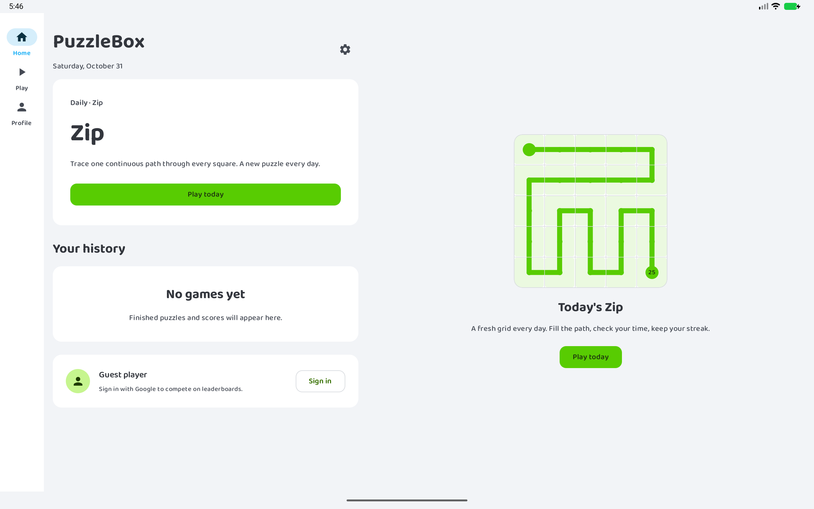
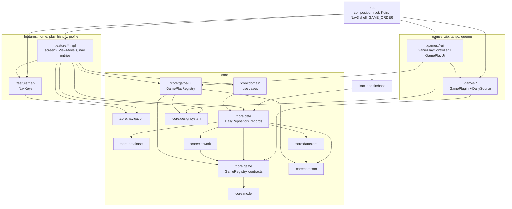

# PuzzleBox

One Android app for daily logic puzzles — play official NYT/LinkedIn dailies, build and share custom games, and compete via leaderboards and 1v1.

> **Status: alpha (0.x)** — Zip ships first; more games (Queens, Tango, MiniSudoku, Strands) and social features are on the roadmap.

<p>
  
</p>

## Why

Official puzzle apps scatter dailies across NYT and LinkedIn with separate logins — and keep no browsable history of your games and scores. PuzzleBox puts them in one place: open the app → today's puzzle or a shared custom game → score recorded → check your rank or challenge a friend → come back tomorrow.

## Features

- **Daily games** — today's puzzle front and center, with a preview grid and streak tracking
- **Play history** — finished puzzles and scores stay browsable (unlike the official apps)
- **Custom games** — build and share puzzles via shareable archives *(planned)*
- **Leaderboards & 1v1** — Google sign-in, compete with friends *(planned)*
- **Adaptive design** — phone and tablet layouts, light and dark themes

## Architecture

Multi-module Gradle project, Kotlin + Compose (Material 3), shaped after
[nowinandroid](https://github.com/android/nowinandroid): convention plugins in `build-logic`
(`puzzlebox.*`), `core:*` layers, one `games:<id>` + `games:<id>-ui` pair per game, and
`feature:<name>:{api,impl}` pairs.



`impl` modules reach another feature only through its `api`; no feature depends on a game;
games plug in through Koin and the `GameRegistry` / `GamePlayRegistry` seams. The forbidden
edges (over every configuration, tests included) are enforced by `./gradlew checkModuleGraph`,
which `check`, `assembleDebug` and `testDebugUnitTest` run — see
[ADR-0008](docs/adr/0008-module-graph.md). Architecture decisions are recorded as ADRs in
[`docs/adr`](docs/adr).

### Adding a game

1. `settings.gradle.kts`: `include(":games:<id>")` and `include(":games:<id>-ui")`.
2. `games/<id>` (`puzzlebox.jvm.library`): the game's `GamePlugin` and `DailySource`, bound in
   its Koin module — the plugin under `qualifier(<Id>Definition.id.value)`, the source with
   `bind DailySource::class`.
3. `games/<id>-ui` (`puzzlebox.android.library.compose`): one `GamePlayController` + one
   `GamePlayUi`, bound in `<id>UiModule` as `single<GamePlayUi>(qualifier = qualifier(<Id>Definition.id.value))`.
4. `app/build.gradle.kts`: `implementation(projects.games.<id>)` and
   `implementation(projects.games.<id>Ui)`.
5. `PuzzleBoxApplication.appModules`: add `<id>Module` and `<id>UiModule`.
6. `app/.../di/AppModule.kt`: add the id to `GAME_ORDER`.

No `core:*` or `feature:*` module changes.

## Tech stack

Kotlin · Jetpack Compose (Material 3) · Coroutines & Flow · Room · Retrofit · Coil · Koin · Paging 3 · Roborazzi (screenshot testing)

## Build

```bash
./gradlew :app:assembleDebug
```

Requires an Android SDK (`ANDROID_HOME` or `local.properties`). Install and run on a connected device/emulator:

```bash
./gradlew :app:installDebug
```

Tests:

```bash
./gradlew testDebugUnitTest :core:game:test :games:zip:test :games:queens:test :games:tango:test :core:model:test :core:network:test -Proborazzi.verify=true
                                       # JVM unit tests against fakes; screenshot goldens in verify mode
./gradlew check                        # tests, lint and the module-graph guard (checkModuleGraph)
```

Without `-Proborazzi.verify=true` the screenshot tests re-record their goldens.
