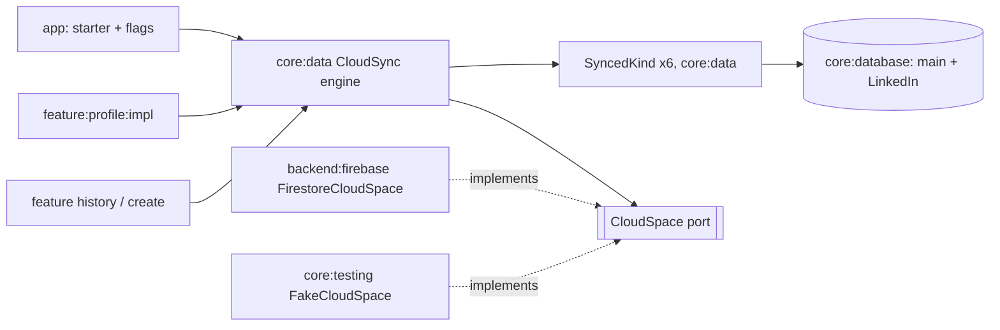

# ADR-0029 — Cloud sync: one owner-only space per account, one engine, one file per kind

Date: 2026-11-11 · Status: accepted · Source: `.scratch/cloud-sync/spec.md` (A1–A45) · Amends ADR-0028 decision 6 and its Consequences (ghosts reach the owner's cloud space; Disconnect keeps saved boards)

## Context
Finished games, drafts, the published list, received puzzles and LinkedIn connections' boards live only in one phone's Room databases. Auto Backup restores the main database once, at install, to the same device account; the LinkedIn database is excluded from backup by design (ADR-0028 §2). A signed-in player wants the same history on every device. Firebase runs on the Spark plan: no server code, one daily quota pool per project (50k reads, 20k writes, 20k deletes, 1 GiB stored) shared with leaderboards, boards and duels, and over quota means rejected requests, never a bill. Existing rule blocks (ADR-0020, -0024, -0026) are immutable-by-design and allow no delete.

## Decision
1. **One owner-only cloud space per account.** All synced data lives under `users/{uid}/{kind}/{docId}`. A new rules block grants read, write and delete only when `request.auth.uid == uid`, validates each kind's keys with `hasOnly` and its sizes, and allows nothing else; `{kind}` is a closed allow-list. It is the first block that allows delete (tombstone cleanup, Delete saved boards, Delete my cloud data). The deny-all default and the five existing blocks stay byte-unchanged; a JVM text guard pins them. Layout per kind:
   - `completions/{yyyy-MM}[-n]`: `{formatVersion, updatedAt, records: {syncId: record}}`, one document per month, a numbered overflow when the month holds 1,000 records;
   - `drafts/{draftId}`, `published/{code}`, `received/{code}`: one document each, `deleted: true` is the tombstone;
   - `boards/{game}_{day}_{profileKey}`: one LinkedIn board, `profileKey` a hash of the owner's LinkedIn profile id;
   - `replays/{syncId}` (last ticket): one replay, fetched only when opened.
   Every document carries `updatedAt = request.time` (rules enforce it), which is the delta-sync cursor.
2. **`CloudSpace` is the seam to the backend (core:data port, `:backend:firebase` adapter).** It is kind-agnostic and speaks plain values (`String`, `Long`, `Boolean`, `ByteArray`, lists and maps of them):
   - `changedSince(uid, kind, cursor: Instant?): CloudResult<List<CloudDoc>>` — server-sourced query `updatedAt >= cursor`, never the SDK cache;
   - `put(uid, kind, docs: List<CloudDoc>): CloudResult<Unit>` — deep-merge sets on deterministic ids in batches; no transaction, no rules-side `get()`; the adapter stamps `updatedAt`;
   - `delete(uid, kind, ids)` and `deleteAll(uid)` (enumerate the known kinds, batch delete).
   The adapter reads the signed-in uid immediately before each commit and returns `WrongAccount` without writing when it differs from `uid`. Every call has a timeout. Results are typed: `Ok`, `Offline` (unavailable, timeout: unknown but safe to repeat), `Exhausted` (quota), `Denied`, `WrongAccount`. No Firebase type and no exception crosses the seam. As in ADR-0020/-0026, the adapter sits on an internal `CloudSpaceStore` over Firestore so its error mapping, uid check and timeouts are tested against a fake store; `core:testing` holds `FakeCloudSpace` (uid from `FakeIdentityService`, read/write/delete counters, a log of every payload) and a `CloudSpaceContract` both pass.
3. **`SyncedKind` is the extension point; one file per kind in core:data.** Each kind implements a small contract: its cloud `kind` name, `encode`/`decode` between local rows and `CloudDoc`, `pending(uid)` (rows owned by `uid` whose content differs from the last acknowledged upload), `apply(uid, docs)` (merge into local storage in one transaction and report counts), and `acknowledge(uid, uploaded)`. The merge rule of each kind is a pure function beside it, table-tested. Kinds: completions, drafts, published, received, LinkedIn boards, replays. A new kind is a new file plus one registration line in the data Koin module.
4. **`CloudSync` engine: pull, merge, push, single flight.** One run for the signed-in uid: adopt ownerless rows, then per kind pull since the per-account cursor, `apply`, push `pending`, `acknowledge` on `Ok` only. Pull runs before push so a conflict resolves locally once and only winners upload. Runs are serialized by a mutex and coalesced (a trigger during a run queues one more run). A daily write cap per account (500) stops a bug loop. Failures: `Offline` waits for the network edge; `Exhausted` and `Denied` pause with capped exponential backoff (1 min doubling to 30 min; Exhausted also waits for the next app start or an explicit Sync now); no failure changes a row's persisted state. `WrongAccount` aborts the run silently. The engine exposes `state: StateFlow<CloudSyncState>` (`SignedOut`, `Syncing(firstRestore)`, `Synced(atMs)`, `Offline(lastAtMs)`, `Paused(reason, lastAtMs)`), `restored: Flow<RestoreSummary>` (once per account per device), `syncNow()`, `eraseCloud()` and `deleteSavedBoards()`. Clock, dispatchers and scope are injected.
5. **Triggers live in the engine's runner, started by the app.** `start(scope)` combines the identity's sign-in edge, the network's false-to-true edge, app start, and the kinds' pending-id sets (distinct, debounced 2 s). A trigger is "content to upload changed", never "a table emitted". No WorkManager, no periodic job, no Firestore listener; screens read Room only. `PuzzleBoxApplication` starts it beside the other starters only with `ReleaseFlag.CloudSync` on, and passes the LinkedIn kind only with `LinkedInAccount` on.
6. **Owner on every synced row.** Synced tables in both databases gain a nullable `ownerUid`. Null means made while signed out; the first run for an account adopts null rows. Readers filter to `ownerUid IS NULL OR ownerUid = :visibleOwner`, where the visible owner is the signed-in uid, else the last signed-in uid (kept in the sync-state store). First win (the one record per puzzle) is computed inside that visible set. Rows of another owner are never pending and never shown.
7. **Local sync state.** Per-row upload markers and tombstones are Room data (main database 10→11: `ownerUid`, completion `syncId` backfilled with random hex, `uploadedAt`/`uploadedVersion`, a `sync_tombstones` table; LinkedIn database 1→2, its first migration: `ownerUid` and a `saved_boards` table holding each board's owner profile, read time, completeness and upload marker). Cursors, the last signed-in uid, "restore shown" flags and the daily write counter live in a separate DataStore file. That file and the Firestore SDK's on-disk cache are excluded from Auto Backup and device transfer; a backup-restored install re-pulls in full, which merge makes harmless.
8. **Merge rules.** Completions merge by `syncId` and keep their original timestamps (their own insert path, never the live finish path); after every merge the record per puzzle is recomputed, earliest `completedAtMs` first, and the record flag is never synced. Drafts: last edit wins by the draft's edit time; tombstones win over older edits; a delete uploads after its undo window. Published: `unpublished` is one-way. Received: payload bytes travel, so restore never depends on the public document. LinkedIn boards merge whole: a complete board is never replaced by a partial one, otherwise the newer read wins; locally one board per (game, day), the currently linked profile's first, else the latest read. Restoring a board marks the day read so no LinkedIn call is spent on it.
9. **UI reads the engine through core:data.** Profile's Google row renders `state` and calls `syncNow`/`eraseCloud`; the LinkedIn row calls `deleteSavedBoards`; History and Create render a restoring state while `Syncing(firstRestore = true)`; the app shell shows `restored` once through the one-shot pattern. No feature talks to `CloudSpace`.

## Consequences
- Two Room migrations ship at the first merge even with the flag off (ADR-0022); neither can be rolled back. The detailed-history run also plans main 10→11; whichever merges second renumbers.
- The rules deploy precedes the flip; a client that reaches Firestore first is paused by `Denied` and resumes by itself once the rules are live.
- Budget at 4 heavy users: under 5% of the daily read and write pool and about 15 MB stored per heavy user-year. A first restore of a year is about 1,500 reads, dominated by board days.
- The rules matrix (`rules-matrix/`) gains the new block's cases; it stays a manual, networked step before each deploy, outside the merge gate.
- Third parties' names and times now leave the phone (owner-only). Play Data safety and the privacy text change before the flip, a human step.
- Delete my cloud data and Delete saved boards need a connection; offline they say so and do nothing.

## Rejected
- **Typed per-kind ports** (`CompletionCloud`, `DraftCloud`, …): each kind would need its own Firestore adapter, so a new kind edits `:backend:firebase` and the extension point is two files in two modules. The kind-agnostic port keeps the adapter one mapping and the kinds in core:data.
- **The Firestore SDK's offline write queue as the outbox:** a queued write reports nothing until the server acknowledges it, and a later denial is silent after process death; the upload marker must be set on acknowledgement.
- **Live listeners per kind:** billed per document again after a 30-minute disconnect and per screen; sync is event-driven by owner choice.
- **Per-row documents for completions and boards:** one document per record costs a read per record on restore; a board per connection costs up to 51 writes per read.
- **WorkManager or periodic sync:** a new dependency and background behavior the owner ruled out; in-process runs are enough because every write is idempotent.
- **Auto Backup as the sync:** install-time only, one device account, and it cannot carry the LinkedIn database.
- **Per-row union of board rows:** it would keep a time a connection later chose to hide.
- **Riding `LinkedInAccount` as the only flag:** sync covers far more than LinkedIn.
